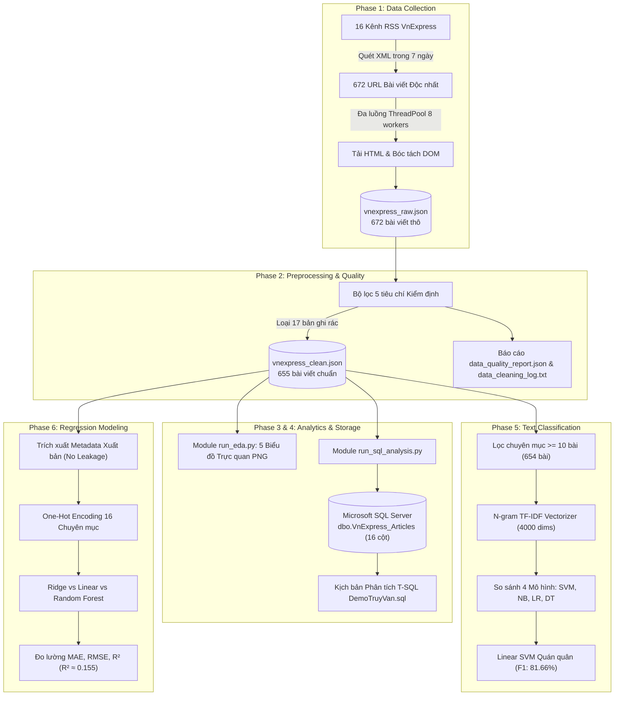

# GIÁO TRÌNH HỌC TẬP VÀ NGHIÊN CỨU DỰ ÁN KHOA HỌC DỮ LIỆU BÁO ĐIỆN TỬ VNEXPRESS
## Học phần: ADY201m - Applied Data Analytics & Machine Learning
**Tài liệu tham chiếu nội bộ – Dành cho Thành viên Dự án & Chuẩn bị Bảo vệ Đồ án**

---

## MỤC LỤC TỔNG QUAN

1. [Chương 1: Giới thiệu Dự án & Bài toán Nghiên cứu](#chương-1-giới-thiệu-dự-án--bài-toán-nghiên-cứu)
2. [Chương 2: Thu thập Dữ liệu Đa tầng (Data Collection)](#chương-2-thu-thập-dữ-liệu-đa-tầng-data-collection)
3. [Chương 3: Tiền xử lý & Kiểm định Chất lượng Dữ liệu (Preprocessing & Data Quality)](#chương-3-tiền-xử-lý--kiểm-định-chất-lượng-dữ-liệu-preprocessing--data-quality)
4. [Chương 4: Phân tích Khám phá Dữ liệu Trực quan (EDA)](#chương-4-phân-tích-khám-phá-dữ-liệu-trực-quan-eda)
5. [Chương 5: Quản trị Dữ liệu Doanh nghiệp & Phân tích T-SQL](#chương-5-quản-trị-dữ-liệu-doanh-nghiệp--phân-tích-t-sql)
6. [Chương 6: Kỹ thuật Kiến tạo Đặc trưng (Feature Engineering)](#chương-6-kỹ-thuật-kiến-tạo-đặc-trưng-feature-engineering)
7. [Chương 7: Mô hình hóa Phân loại Văn bản Đa lớp (Text Classification)](#chương-7-mô-hình-hóa-phân-loại-văn-bản-đa-lớp-text-classification)
8. [Chương 8: Mô hình hóa Hồi quy & Tính Toàn vẹn Khoa học (Regression Analysis)](#chương-8-mô-hình-hóa-hồi-quy--tính-toàn-vẹn-khoa-học-regression-analysis)
9. [Chương 9: Hướng dẫn Cấu trúc Thư mục & Vận hành Mã nguồn (Codebase Guide)](#chương-9-hướng-dẫn-cấu-trúc-thư-mục--vận-hành-mã-nguồn-codebase-guide)
10. [Chương 10: Tổng kết Đóng góp, Giới hạn & Hướng Phát triển](#chương-10-tổng-kết-đóng-góp-giới-hạn--hướng-phát-triển)

---

## CHƯƠNG 1: GIỚI THIỆU DỰ ÁN & BÀI TOÁN NGHIÊN CỨU

### 1.1. Bối cảnh Nghiên cứu
Trong kỷ nguyên bùng nổ thông tin số, báo điện tử là kênh truyền tải thông tin chính yếu định hình nhận thức xã hội. Hàng ngày, hàng ngàn bài báo được xuất bản với khối lượng nội dung văn bản khổng lồ. Việc phân tích định lượng dữ liệu báo chí (News Data Analytics) đóng vai trò then chốt giúp:
- Tòa soạn nắm bắt xu hướng xuất bản, phân bổ nhân lực phóng viên và tối ưu hóa thời gian đăng bài.
- Xây dựng hệ thống tự động gắn nhãn (Auto-tagging / Classification) hỗ trợ phân loại luồng tin tức theo danh mục.
- Khám phá các thuộc tính cấu trúc ảnh hưởng tới dung lượng bài viết báo chí.

### 1.2. Tại sao lựa chọn Báo điện tử VnExpress?
VnExpress (`vnexpress.net`) được lựa chọn làm đối tượng nghiên cứu chính dựa trên 3 luận cứ khoa học:
1. **Quy mô và vị thế dẫn đầu:** Là một trong những trang báo điện tử tiếng Việt có lượng truy cập lớn nhất, chuẩn mực biên tập chặt chẽ và văn phong tiếng Việt chuẩn xác.
2. **Hệ thống phân phối RSS minh bạch:** VnExpress cung cấp các luồng tin RSS định dạng XML riêng biệt cho từng chuyên mục, cho phép trích xuất các bài báo mới nhất một cách chuẩn hóa.
3. **Cấu trúc DOM phân cấp cao:** Mã nguồn HTML của các bài viết có cấu trúc ngữ nghĩa rõ ràng (`title-detail`, `description`, `fck_detail`, `breadcrumb`), tạo điều kiện thuận lợi cho việc bóc tách dữ liệu có cấu trúc.

### 1.3. Mục tiêu & Các Câu hỏi Nghiên cứu (Research Questions)
Dự án được xây dựng nhằm giải quyết 4 câu hỏi nghiên cứu cốt lõi:
- **RQ1 (Xu hướng Phân bố):** Khung giờ nào và chuyên mục nào có sản lượng xuất bản cao nhất trên VnExpress trong một chu kỳ tuần?
- **RQ2 (Dung lượng Nội dung):** Độ dài bài báo (tính theo số từ) phân bố như thế nào giữa các thể loại tin tức và giữa ngày thường so với cuối tuần?
- **RQ3 (Tự động Phân loại Thể loại):** Có thể dự đoán chính xác chuyên mục của một bài viết dựa trên không gian đặc trưng từ vựng TF-IDF hay không? Thuật toán học máy nào mang lại hiệu năng tối ưu nhất?
- **RQ4 (Dự đoán Dung lượng Bài viết):** Liệu các thông tin siêu dữ liệu xuất bản (thời gian đăng, độ dài tiêu đề, chuyên mục) có thể giải thích được biến thiên dung lượng của bài báo hay không mà không gây ra hiện tượng rò rỉ dữ liệu (Data Leakage)?

### 1.4. Sơ đồ Luồng Công việc Toàn diện (End-to-End Workflow)



---

## CHƯƠNG 2: THU THẬP DỮ LIỆU ĐA TẦNG (DATA COLLECTION)

### 2.1. Khái niệm Web Crawling & RSS Feeds
- **Web Crawling:** Quá trình tự động gửi yêu cầu HTTP đến máy chủ, tải nội dung tài liệu (HTML) và duyệt theo các liên kết siêu văn bản.
- **RSS (Really Simple Syndication):** Kênh phân phối nội dung tóm tắt dạng XML. Mỗi phần tử `<item>` trong RSS chứa thông tin định danh: `<title>`, `<link>`, `<description>`, `<pubDate>`.

### 2.2. Chiến lược 2 Giai đoạn Thu thập trong `crawl_vnexpress.py`
Thay vì quét vét ngẫu nhiên toàn bộ trang web (dễ bị khóa IP hoặc cào bài quá cũ), hệ thống kết hợp thông minh giữa RSS và Web Scraping:
1. **Giai đoạn 1 – Lọc nhanh danh mục qua RSS:** Duyệt qua 16 chuyên mục chính thống, phân tích trường `<pubDate>`. Nếu mốc thời gian bài viết nằm trong 7 ngày gần nhất, đường dẫn URL được ghi nhận vào bảng băm `urls = {}` để triệt tiêu trùng lặp ngay từ nguồn.
2. **Giai đoạn 2 – Bóc tách chi tiết qua đa luồng (Multi-threading):** Khởi tạo một nhóm 8 luồng làm việc song song (`ThreadPoolExecutor(max_workers=8)`), gửi request tải mã nguồn HTML của từng bài báo và bóc tách dữ liệu vào đối tượng từ điển.

```python
CATEGORIES = [
    "thoi-su", "the-gioi", "kinh-doanh", "bat-dong-san", "khoa-hoc-cong-nghe",
    "giai-tri", "the-thao", "phap-luat", "giao-duc", "suc-khoe", "doi-song",
    "du-lich", "oto-xe-may", "tam-su", "y-kien", "thu-gian"
]
```

### 2.3. Bóc tách DOM và Giải thuật Heuristic Định danh Tác giả
Trích xuất tên tác giả bài báo luôn là một thách thức lớn trong khai phá dữ liệu web do mỗi loại hình bài viết (tin nhanh, phóng sự, ý kiến) có cấu trúc hiển thị khác nhau. Hàm `extract_author(soup)` được hiện thực với giải thuật phân tầng ngữ cảnh:

```python
def extract_author(soup):
    """Trích xuất tên tác giả bài viết từ thẻ tác giả hoặc thẻ chữ đậm cuối bài."""
    author_tag = soup.find("p", class_="author_mail") or soup.find("p", class_="author")
    if author_tag:
        author_text = author_tag.text.strip()
        if author_text:
            return author_text
    
    # Heuristic: Thử lấy dòng chữ đậm cuối cùng của phần thân bài (bút danh phóng viên)
    strong_tags = soup.select(".fck_detail p.Normal strong, article p strong")
    if strong_tags:
        last_strong = strong_tags[-1].text.strip()
        if last_strong and len(last_strong.split()) <= 6 and not last_strong.endswith(":"):
            return last_strong

    meta_author = soup.find("meta", {"name": "author"})
    if meta_author and meta_author.get("content"):
        return meta_author["content"].strip()

    return "VnExpress"
```

> [!NOTE]
> Nhờ giải thuật heuristic này, hệ thống bóc tách thành công danh tính của **226 tác giả và phóng viên chuyên trách** thay vì chỉ gán nhãn tĩnh mặc định là tòa soạn VnExpress.

### 2.4. Mẫu Bản ghi Dữ liệu Thô Thực tế (`vnexpress_raw.json`)
```json
{
  "article_id": "5144462",
  "title": "Chủ tịch và Phó chủ tịch UBND tỉnh Tuyên Quang bị kỷ luật",
  "description": "Ủy ban Kiểm tra Trung ương kỷ luật cảnh cáo Chủ tịch tỉnh Tuyên Quang...",
  "content": "Ngày 13/11, thông cáo của Ủy ban Kiểm tra Trung ương cho biết...",
  "author": "VnExpress",
  "published_at": "2026-11-13 19:14:00",
  "category": "Thời sự",
  "subcategory": "Chính trị",
  "url": "https://vnexpress.net/chu-tich-va-pho-chu-tich-ubnd-tinh-tuyen-quang-bi-ky-luat-5144462.html",
  "og_type": "article",
  "raw_word_count": 896,
  "crawled_at": "2026-11-14 00:08:42"
}
```

---

## CHƯƠNG 3: TIỀN XỬ LÝ & KIỂM ĐỊNH CHẤT LƯỢNG DỮ LIỆU (PREPROCESSING & DATA QUALITY)

### 3.1. Phân biệt Bản chất giữa Thu thập (Phase 1) và Tiền xử lý (Phase 2)
- **Lọc khi cào (Phase 1):** Chỉ là kiểm tra sơ bộ trên đường truyền mạng (bỏ qua các link RSS quá cũ để tránh tốn băng thông tải HTML).
- **Tiền xử lý & Kiểm định (Phase 2):** Phân tích tĩnh toàn diện trên toàn bộ nội dung tệp thô, thực hiện chuẩn hóa kiểu dữ liệu, loại bỏ dữ liệu rác, thẩm định tính toàn vẹn (Data Integrity) và phát hiện dị biệt.

### 3.2. Bộ Quy tắc 5 Tiêu chuẩn Sàng lọc Dữ liệu
Trong tệp `clean_and_validate.py`, mỗi bản ghi thô phải vượt qua 5 cổng kiểm định khắt khe:
1. **Kiểm tra tính trùng lặp (Deduplication):** Loại trừ nếu `article_id` hoặc `url` đã tồn tại trong tập băm `seen_ids` và `seen_urls`.
2. **Kiểm tra tiêu đề hợp lệ:** Tiêu đề không được phép là chuỗi rỗng hoặc chỉ chứa ký tự khoảng trắng trắng sau khi `.strip()`.
3. **Kiểm tra định dạng nội dung (`og_type`):** Loại trừ các trang phi văn bản (`og_type: website`).
4. **Kiểm tra dung lượng văn bản tối thiểu:** Loại trừ bài viết có độ dài dưới 50 từ (`word_count < 50`). Đây là các bài phóng sự ảnh (Photo Story) hoặc video clip chỉ có tiêu đề mà không có nội dung chữ, không có giá trị cho mô hình hóa ngôn ngữ.
5. **Kiểm tra tính hợp lệ của mốc thời gian:** Chuẩn hóa chuỗi thời gian về định dạng chuẩn ISO `YYYY-MM-DD HH:MM:SS` và xác nhận nằm trong phạm vi 7 ngày gần nhất.

### 3.3. Kết quả Thực nghiệm Kiểm định Chất lượng Dữ liệu
Bảng đối chiếu số liệu trích xuất từ báo cáo `data_quality_report.json`:

| Chỉ số Kiểm định | Số lượng / Kết quả | Ý nghĩa Khoa học |
| :--- | :---: | :--- |
| **Tổng số bản ghi thô (Raw)** | **672 bài** | Thu thập từ 16 chuyên mục RSS |
| **Tổng số bản ghi sạch (Clean)** | **655 bài** | Đạt chuẩn 100% về tính toàn vẹn |
| **Số bản ghi bị loại trừ** | **17 bài** | Tỷ lệ loại trừ $2.53\%$ |
| - Bài viết dưới 50 từ (ảnh/video) | 7 bài | Ngăn chặn nhiễu trong xử lý văn bản |
| - Định dạng phi văn bản (`og_type: website`) | 4 bài | Trang landing page danh mục |
| - Vượt ngoài cửa sổ 7 ngày | 4 bài | Đảm bảo tính tươi của chu kỳ tin tức |
| - Tiêu đề rỗng / khoảng trắng | 2 bài | Bản ghi khuyết tật |
| **Trùng lặp ID và URL** | **0 bản ghi** | Tính duy nhất đạt 100% |
| **Giá trị Missing (Null)** | **0 trường hợp** | Không có giá trị thiếu ở mọi trường |
| **Chuỗi ký tự rỗng (Empty String)** | **0 trường hợp** | Không có chuỗi vô nghĩa |
| **Số tác giả độc nhất nhận diện** | **226 tác giả** | Phục vụ phân tích nhân sự tòa soạn |

---

## CHƯƠNG 4: PHÂN TÍCH KHÁM PHÁ DỮ LIỆU TRỰC QUAN (EDA)

Phân tích khám phá dữ liệu (EDA) là bước bắt buộc nhằm thấu hiểu cấu trúc thống kê, hình dạng phân phối và các mẫu hình hành vi trước khi xây dựng mô hình học máy. Module `run_eda.py` tự động hóa việc xuất bản 5 biểu đồ phân tích chuyên sâu.

### 4.1. Biểu đồ 1: Phân bố Bài viết theo Chuyên mục (`bieu_do_1_chuyen_muc.png`)
- **Loại biểu đồ:** Biểu đồ cột đứng (Vertical Bar Chart).
- **Biến phân tích:** Trục hoành ($X$) là 17 chuyên mục tin tức; Trục tung ($Y$) là số lượng bài viết xuất bản.
- **Quan sát thực tế:**
  - Chuyên mục có số lượng tin lớn nhất: **Pháp luật** (59 bài), **Thể thao** (56 bài), **Giải trí** (55 bài), **Thời sự** (54 bài).
  - Chuyên mục có số bài thấp nhất: **Ý kiến** (22 bài), và cá biệt có 1 bài mang nhãn **Tin tức** (do phân cấp đặc thù của VnExpress).
- **Ý nghĩa nghiệp vụ:** VnExpress tập trung nguồn lực nội dung mạnh nhất vào các mảng tin đời sống dân sinh, an ninh pháp luật và sự kiện thể thao – giải trí nhằm thu hút tương tác độc giả cao nhất.

### 4.2. Biểu đồ 2: Tần suất Xuất bản theo Khung giờ trong Ngày (`bieu_do_2_phan_bo_gio.png`)
- **Loại biểu đồ:** Biểu đồ đường (Line Chart with Markers).
- **Biến phân tích:** Trục hoành ($X$) là 24 giờ trong ngày (từ 0h đến 23h); Trục tung ($Y$) là số lượng bài viết được xuất bản tại mỗi giờ.
- **Quan sát thực tế:**
  - Đạt đỉnh cao nhất vào lúc **11:00 trưa** (61 bài), theo sau là **09:00 sáng** (54 bài) và **14:00 chiều** (52 bài).
  - Khung giờ nửa đêm ghi nhận 46 bài xuất bản lúc **00:00**, đây là các bài viết được hẹn giờ tự động để độc giả đọc vào sáng sớm.
  - Từ 01:00 đến 05:00 sáng, số lượng bài viết gần như bằng 0 (thời gian nghỉ của tòa soạn).
- **Ý nghĩa nghiệp vụ:** Chiến lược xuất bản đồng bộ hoàn hảo với chu kỳ sinh hoạt của người dùng: đọc báo trước giờ ăn trưa (9h-11h) và đầu giờ chiều (14h).

### 4.3. Biểu đồ 3: Phân bố Độ dài Bài viết (`bieu_do_3_phan_bo_tu.png`)
- **Loại biểu đồ:** Biểu đồ kết hợp Histogram (35 bins) và đường ước lượng mật độ nhân (KDE - Kernel Density Estimation).
- **Biến phân tích:** Trục hoành ($X$) là số từ trong thân bài (`word_count`); Trục tung ($Y$) là tần suất xuất hiện.
- **Đặc trưng thống kê quan trọng:**
  - **Hình dạng phân phối:** Phân phối lệch phải rõ rệt (Right-skewed Distribution).
  - **Giá trị thống kê:** Giá trị nhỏ nhất là 61 từ, lớn nhất là 4,139 từ. Độ lệch chuẩn $\sigma = 466.06$ từ.
  - **So sánh Mean và Median:** Trung vị (Median = 691.0 từ) nằm bên trái giá trị trung bình (Mean = 779.3 từ).
- **Giải thích hiện tượng:** Đa số các bài báo tập trung ở ngưỡng dung lượng vừa phải (500 - 800 từ) để phục vụ độc giả di động. Tuy nhiên, sự xuất hiện của các bài bình luận, phân tích chuyên sâu dài từ 2,000 đến hơn 4,000 từ đã kéo giá trị trung bình lệch về phía bên phải.

### 4.4. Biểu đồ 4: Độ dài Trung bình Bài viết theo Chuyên mục (`bieu_do_4_do_dai_chuyen_muc.png`)
- **Loại biểu đồ:** Biểu đồ thanh ngang (Horizontal Bar Chart).
- **Biến phân tích:** Trục tung ($Y$) là các chuyên mục; Trục hoành ($X$) là số từ trung bình của mỗi chuyên mục.
- **Quan sát thực tế:**
  - **Nhóm bài dài nhất:** **Thể thao** (1,019 từ/bài), **Bất động sản** (1,003 từ/bài), **Khoa học công nghệ** (939 từ/bài), **Thời sự** (912 từ/bài).
  - **Nhóm bài ngắn nhất:** **Xe** (554 từ/bài), và đặc biệt **Thư giãn** chỉ có 216 từ/bài.
- **Ý nghĩa nghiệp vụ:** Tin tức thể thao chuyên sâu và bất động sản đòi hỏi phân tích số liệu trận đấu, quy hoạch thị trường nên có dung lượng văn bản lớn. Ngược lại, mục Thư giãn chủ yếu là truyện cười ngắn, câu đố nên số từ rất thấp.

### 4.5. Biểu đồ 5: Top 10 Tác giả/Phóng viên Tích cực nhất (`bieu_do_5_top_tac_gia.png`)
- **Loại biểu đồ:** Biểu đồ cột đứng.
- **Biến phân tích:** Trục hoành ($X$) là tên tác giả cá nhân (đã lọc bỏ nhãn tòa soạn chung); Trục tung ($Y$) là sản lượng bài viết.
- **Quan sát thực tế:**
  - Dẫn đầu là phóng viên **Mộc Trà** (17 bài), **Hồng Duy** (15 bài), **Hà Thu** (13 bài), **Song Anh** (12 bài), **Như Anh** (10 bài), **An Khang** (10 bài).
- **Ý nghĩa nghiệp vụ:** Minh chứng tính hiệu quả của thuật toán Heuristic bóc tách tác giả từ chữ ký cuối bài, cung cấp dữ liệu định lượng phục vụ công tác quản trị hiệu suất phóng viên.

---

## CHƯƠNG 5: QUẢN TRỊ DỮ LIỆU DOANH NGHIỆP & PHÂN TÍCH T-SQL

Hệ quản trị CSDL quan hệ **Microsoft SQL Server** được tích hợp làm kho lưu trữ trung tâm dữ liệu chuẩn hóa theo kiến trúc doanh nghiệp. Toàn bộ 655 bài báo sạch được quản lý trong một bảng duy nhất `dbo.VnExpress_Articles` gồm 16 cột thuộc tính.

### 5.1. Thiết kế Lược đồ CSDL Chuẩn hóa (`SQLschema.sql`)
```sql
CREATE TABLE dbo.VnExpress_Articles (
    article_id          NVARCHAR(50)   NOT NULL CONSTRAINT PK_VnExpress_Articles PRIMARY KEY,
    title               NVARCHAR(1000) NOT NULL,
    description         NVARCHAR(MAX)  NULL,
    content             NVARCHAR(MAX)  NOT NULL,
    author              NVARCHAR(255)  NOT NULL,
    published_at        DATETIME       NOT NULL,
    publish_date        DATE           NOT NULL,
    publish_hour        INT            NOT NULL,
    publish_dayofweek   NVARCHAR(50)   NOT NULL,
    is_weekend          INT            NOT NULL,
    category            NVARCHAR(100)  NOT NULL,
    subcategory         NVARCHAR(100)  NULL,
    url                 NVARCHAR(1000) NOT NULL,
    word_count          INT            NOT NULL,
    title_length        INT            NOT NULL,
    desc_length         INT            NOT NULL
);

-- Tối ưu hóa hiệu năng truy vấn qua Non-Clustered Indexes
CREATE NONCLUSTERED INDEX IX_VnExpress_Category ON dbo.VnExpress_Articles(category);
CREATE NONCLUSTERED INDEX IX_VnExpress_PublishDate ON dbo.VnExpress_Articles(publish_date);
CREATE NONCLUSTERED INDEX IX_VnExpress_Author ON dbo.VnExpress_Articles(author);
```

### 5.2. Các Truy vấn T-SQL Phân tích Nghiệp vụ Tiêu biểu (`DemoTruyVan.sql`)

#### Truy vấn 1: Thống kê Sản lượng và Thị phần Xuất bản theo Chuyên mục
```sql
SELECT 
    category, 
    COUNT(*) AS article_count,
    ROUND(COUNT(*) * 100.0 / (SELECT COUNT(*) FROM dbo.VnExpress_Articles), 2) AS percentage
FROM dbo.VnExpress_Articles
GROUP BY category
ORDER BY article_count DESC;
```

#### Truy vấn 2: Phân tích Xu hướng Xuất bản Ngày thường vs. Cuối tuần
```sql
SELECT 
    CASE WHEN is_weekend = 1 THEN N'Cuối tuần (T7, CN)' ELSE N'Ngày trong tuần (T2-T6)' END AS period_type,
    COUNT(*) AS total_articles,
    ROUND(AVG(CAST(word_count AS FLOAT)), 1) AS avg_words_per_article
FROM dbo.VnExpress_Articles
GROUP BY is_weekend
ORDER BY is_weekend ASC;
```
*Kết quả phân tích T-SQL thực tế:*
- Ngày trong tuần (Thứ 2 - Thứ 6): **610 bài viết** ($\approx 93.1\%$), trung bình **787.9 từ/bài**.
- Ngày cuối tuần (Thứ 7 - Chủ Nhật): **45 bài viết** ($\approx 6.9\%$), trung bình **663.3 từ/bài**.
- *Nhận định nghiệp vụ:* Tòa soạn tập trung cường độ thông tin vào các ngày làm việc; bài viết cuối tuần giảm mạnh cả về số lượng lẫn dung lượng từ.

---

## CHƯƠNG 6: KỸ THUẬT KIẾN TẠO ĐẶC TRƯNG (FEATURE ENGINEERING)

Kiến tạo đặc trưng là cầu nối biến đổi dữ liệu thô thành các biểu diễn số học phù hợp cho các thuật toán học máy.

### 6.1. Đặc trưng Không gian Từ vựng (Text Features cho Phân loại)
Để không bị mất mát thông tin ngữ cảnh, toàn bộ thông tin văn bản được hợp nhất:
$$\text{text\_feature} = \text{title} + " " + \text{description} + " " + \text{content}$$

Sau đó, văn bản được số hóa bằng phương pháp **TF-IDF (Term Frequency - Inverse Document Frequency)** kết hợp trích xuất Unigram và Bigram:
- **Unigram:** Nắm bắt các từ đơn cốt lõi (ví dụ: `vàng`, `cổ phiếu`, `bị can`).
- **Bigram:** Nắm bắt cụm hai từ liền kề có ý nghĩa chuyên biệt trong tiếng Việt (ví dụ: `bất động`, `động sản`, `khoa học`, `thị trường`).
- **Công thức tính trọng số:**
  $$\text{TF-IDF}(t, d, D) = \text{TF}(t, d) \times \left( \log\frac{1 + |D|}{1 + |\{d \in D : t \in d\}|} + 1 \right)$$
- Cấu hình trong mã nguồn: `TfidfVectorizer(max_features=4000, ngram_range=(1, 2), min_df=2)`. Kết quả tạo ra ma trận thưa (Sparse Matrix) kích thước $(523, 4000)$ trên tập huấn luyện.

### 6.2. Đặc trưng Siêu dữ liệu Xuất bản (Metadata Features cho Hồi quy)
Để giải quyết bài toán dự đoán `word_count`, các đặc trưng sau được kiến tạo:
1. `title_words`: Số từ trong tiêu đề (đo lường mức độ cô đọng của chủ đề).
2. `desc_words`: Số từ trong phần sapo (đo lường độ chi tiết ban đầu).
3. `publish_hour`: Khung giờ xuất bản (0 - 23).
4. `publish_dayofweek`: Thứ trong tuần (0 - 6).
5. `is_weekend`: Biến cờ nhị phân đánh dấu ngày cuối tuần.
6. **Mã hóa One-Hot Chuyên mục (One-Hot Encoding):** 16 biến nhị phân đại diện cho các thể loại bài viết (`cat_Du lịch`, `cat_Giáo dục`,...), sử dụng đối số `drop_first=True` để tránh bẫy đa cộng tuyến hoàn hảo (Dummy Variable Trap).

---

## CHƯƠNG 7: MÔ HÌNH HÓA PHÂN LOẠI VĂN BẢN ĐA LỚP (TEXT CLASSIFICATION)

Module `train_classifier.py` thực hiện so sánh đối chuẩn 4 thuật toán học máy phân loại thể loại tin tức.

### 7.1. Chuẩn bị Dữ liệu & Phân tầng
- Loại trừ chuyên mục thưa thớt dị biệt (`Tin tức`: 1 bài) để đảm bảo chia phân tầng thành công. Tập dữ liệu mô hình gồm **654 bài viết thuộc 16 chuyên mục**.
- Sử dụng phương pháp **Stratified Train-Test Split (80% Train, 20% Test)** với `random_state=42`:
  - Tập huấn luyện (Train Set): **523 bài viết**.
  - Tập kiểm thử độc lập (Test Set): **131 bài viết**.

### 7.2. So sánh Hiệu năng 4 Thuật toán Thực nghiệm

| Thuật toán Phân loại | Accuracy | Precision (Weighted) | Recall (Weighted) | Macro F1 | Weighted F1 | Đánh giá Kỹ thuật |
| :--- | :---: | :---: | :---: | :---: | :---: | :--- |
| **Linear SVM (LinearSVC)** | **83.21%** | **82.97%** | **83.21%** | **77.89%** | **81.66%** | **Tối ưu nhất**: Tách siêu phẳng biên cực đại trên không gian thưa 4000 chiều |
| **Multinomial Naive Bayes** | 77.10% | 76.51% | 77.10% | 71.10% | 75.19% | Phù hợp cao với phân bố tần suất từ vựng, tính toán cực nhanh |
| **Logistic Regression** | 73.28% | 69.71% | 73.28% | 65.58% | 70.03% | Độ chính xác khá, suy giảm ở các lớp có ít mẫu |
| **Decision Tree** | 52.67% | 52.46% | 52.67% | 50.94% | 51.46% | Kém nhất: Dễ bị quá khớp (overfitting) do phân chia trực giao trên số chiều lớn |

### 7.3. Phân tích Chi tiết Mô hình Quán quân Linear SVM
- **Tại sao Linear SVM chiến thắng?** Văn bản sau khi qua TF-IDF tạo ra không gian 4,000 chiều cực kỳ thưa. Trong hình học nhiều chiều, các lớp văn bản có xu hướng phân tách tuyến tính. SVM tìm kiếm siêu phẳng có khoảng cách lề lớn nhất ($\max \frac{2}{\|\mathbf{w}\|}$), giúp kiểm soát quá khớp vượt trội so với cây quyết định.
- **Phân tích Ma trận Nhầm lẫn (`confusion_matrix.png`):**
  - Các chuyên mục đạt điểm F1 hoàn hảo hoặc rất cao: **Bất động sản** (Precision 0.82, Recall 1.0, F1 0.90), **Thời sự** (F1 0.90), **Pháp luật** (F1 0.85), **Thể thao** (F1 0.95). Đây là những chuyên mục sở hữu bộ từ vựng đặc trưng rõ nét (ví dụ: "chủ tịch", "khởi tố", "bàn thắng", "chung cư").
  - Sự nhầm lẫn nhỏ xảy ra giữa **Đời sống** và **Tâm sự** do hai chuyên mục này có sự giao thoa từ vựng về gia đình, hôn nhân, tình cảm.

---

## CHƯƠNG 8: MÔ HÌNH HÓA HỒI QUY & TÍNH TOÀN VẸN KHOA HỌC (REGRESSION ANALYSIS)

Module `train_regression.py` thử nghiệm bài toán dự đoán dung lượng bài viết (`word_count`) từ thông tin xuất bản.

### 8.1. Đảm bảo Tuyệt đối Không Rò rỉ Dữ liệu (Zero Data Leakage)
Trong nghiên cứu học máy, hiện tượng rò rỉ dữ liệu (Data Leakage) xảy ra khi mô hình sử dụng các biến đầu vào chứa đựng thông tin của biến mục tiêu mà thực tế không thể có trước khi bài viết được xuất bản.
- **Biện pháp kỹ thuật nghiêm ngặt:** Nhóm **hoàn toàn loại bỏ** các biến phái sinh từ thân bài (như số lượng câu trong bài, số ký tự của bài báo, số lượng ảnh trong bài).
- Toàn bộ 21 biến đầu vào chỉ bao gồm **Metadata xuất bản**: số từ của tiêu đề, số từ của sapo, giờ đăng, thứ trong tuần, cờ cuối tuần và các biến giả chuyên mục.

### 8.2. Kết quả Thực nghiệm So sánh 3 Thuật toán Hồi quy

| Thuật toán Hồi quy | MAE (Sai số Tuyệt đối) | RMSE (Căn sai số Bình phương) | Hệ số Xác định $R^2$ | Nhận xét Thực nghiệm |
| :--- | :---: | :---: | :---: | :--- |
| **Ridge Regression ($\alpha=1.0$)** | **306.18 từ** | **441.09 từ** | **0.1554** | **Tốt nhất**: Hiệu chỉnh chuẩn L2 giúp co trọng số, chống quá khớp trên biến giả |
| **Linear Regression** | 306.43 từ | 441.15 từ | 0.1552 | Tương đương Ridge nhưng nhạy cảm hơn với đa cộng tuyến |
| **Random Forest Regressor** | 322.82 từ | 478.69 từ | 0.0053 | Kém nhất: Không có khả năng ngoại suy trên các bài báo ngoại lai dài > 2000 từ |

### 8.3. Biện luận Khoa học về Hệ số $R^2 \approx 0.155$
Khi bảo vệ đồ án trước Hội đồng Giảng viên, một câu hỏi kinh điển là: *"Tại sao $R^2$ chỉ đạt 0.155 (15.5%)? Mô hình này có bị coi là thất bại không?"*
- **Câu trả lời chuẩn khoa học:** Đây là minh chứng cho sự trung thực khoa học của đề tài:
  1. Độ dài của một bài báo phụ thuộc chủ yếu vào **tính chất của sự kiện thực tế diễn ra ngoài đời** (một sự kiện đột xuất lớn bắt buộc bài báo phải dài) và **ý đồ nghệ thuật/phong cách của tác giả**.
  2. Các thông tin siêu dữ liệu (giờ đăng, thứ trong tuần, chuyên mục) chỉ giải thích được khoảng 15.5% sự biến thiên của dung lượng bài viết.
  3. Nếu sinh viên nào tuyên bố mô hình dự đoán độ dài bài viết từ metadata đạt $R^2 > 0.8$, chắc chắn họ đã phạm sai lầm dùng số ký tự thân bài để dự đoán số từ thân bài (Data Leakage nghiêm trọng).

---

## CHƯƠNG 9: HƯỚNG DẪN CẤU TRÚC THƯ MỤC & VẬN HÀNH MÃ NGUỒN (CODEBASE GUIDE)

### 9.1. Sơ đồ Cây Thư mục Dự án
```text
ADY201m Final Completed/
├── requirements.txt                        # Danh mục thư viện Python yêu cầu
├── README.md                               # Tổng quan đồ án và phân công nhiệm vụ
├── Final_Report.docx                       # Báo cáo tổng kết đồ án chính thức
├── ProfessorRequirement.txt                # Yêu cầu đề bài và rubric chấm điểm môn học
├── PROJECT_LEARNING_GUIDE.md               # Giáo trình học tập toàn diện (Tài liệu này)
├── PROJECT_GLOSSARY.md                     # Từ điển thuật ngữ kỹ thuật Anh - Việt
├── PROJECT_QA.md                           # Sổ tay 20 câu hỏi vấn đáp và 8 bài tập thực hành
│
├── Phase 1 - Data Collection/              # Giai đoạn 1: Thu thập Dữ liệu
│   ├── crawl_vnexpress.py                  # Module thu thập đa luồng 16 chuyên mục RSS
│   └── vnexpress_raw.json                  # Dữ liệu cào thô (672 bài viết)
│
├── Phase 2 - Data Preprocessing & Quality/ # Giai đoạn 2: Tiền xử lý & Kiểm định
│   ├── clean_and_validate.py               # Module tiền xử lý, kiểm tra tính toàn vẹn
│   ├── vnexpress_clean.json                # Dữ liệu sạch sau tiền xử lý (655 bài viết)
│   ├── data_quality_report.json            # Báo cáo thống kê chất lượng dữ liệu chi tiết
│   └── data_cleaning_log.txt               # Nhật ký loại trừ 17 bản ghi không đạt chuẩn
│
├── Phase 3 - Exploratory Data Analysis/    # Giai đoạn 3: Phân tích Khám phá Dữ liệu
│   ├── run_eda.py                          # Module trực quan hóa tự động 5 biểu đồ
│   ├── bieu_do_1_chuyen_muc.png            # Biểu đồ số lượng bài theo chuyên mục
│   ├── bieu_do_2_phan_bo_gio.png           # Biểu đồ tần suất xuất bản theo khung giờ
│   ├── bieu_do_3_phan_bo_tu.png            # Biểu đồ phân bố độ dài từ bài viết
│   ├── bieu_do_4_do_dai_chuyen_muc.png     # Biểu đồ độ dài trung bình theo thể loại
│   └── bieu_do_5_top_tac_gia.png           # Biểu đồ Top 10 tác giả/phóng viên tích cực
│
├── Phase 4 - SQL Analysis/                 # Giai đoạn 4: CSDL & Phân tích T-SQL
│   ├── run_sql_analysis.py                 # Module nạp dữ liệu sạch vào Microsoft SQL Server
│   ├── SQLschema.sql                       # Kịch bản DDL tạo Database và bảng 16 cột
│   └── DemoTruyVan.sql                     # Kịch bản 6 câu lệnh T-SQL phân tích nghiệp vụ
│
├── Phase 5 - Classification Modeling/      # Giai đoạn 5: Mô hình Hóa Phân loại
│   ├── train_classifier.py                 # Module huấn luyện và so sánh 4 mô hình phân loại
│   ├── category_classifier_model.joblib    # Trọng số mô hình Linear SVM tốt nhất lưu trữ
│   ├── tfidf_vectorizer.joblib             # Bộ vector hóa TF-IDF (4,000 n-grams)
│   ├── confusion_matrix.png                # Ma trận nhầm lẫn của Linear SVM
│   ├── model_comparison_bar.png            # Biểu đồ so sánh 4 thuật toán phân loại
│   └── classification_metrics.json         # Chi tiết các chỉ số Accuracy, Precision, F1
│
└── Phase 6 - Regression Modeling/          # Giai đoạn 6: Mô hình Hóa Hồi quy
    ├── train_regression.py                 # Module huấn luyện và đánh giá mô hình hồi quy
    ├── article_word_count_regressor.joblib # Trọng số mô hình Ridge Regression lưu trữ
    ├── regression_actual_vs_predicted.png  # Biểu đồ Thực tế vs. Dự đoán
    ├── regression_residuals_plot.png       # Biểu đồ phân tích phần dư (Residuals)
    ├── regression_comparison_bar.png       # Biểu đồ so sánh sai số MAE & RMSE
    └── regression_metrics.json             # Bảng đo lường sai số và hệ số xác định R²
```

### 9.2. Hướng dẫn Từng bước Thực thi Dự án từ Đầu đến Cuối (Execution Runbook)

#### Bước 1: Cài đặt Môi trường
Mở PowerShell hoặc Command Prompt tại thư mục dự án:
```powershell
pip install -r requirements.txt
```

#### Bước 2: Chạy Tuần tự Từng Phase

```powershell
# 1. Thu thập dữ liệu từ VnExpress (chỉ chạy khi muốn làm mới dữ liệu)
python "Phase 1 - Data Collection\crawl_vnexpress.py"

# 2. Tiền xử lý, lọc bỏ 17 bài rác và thẩm định chất lượng dữ liệu
python "Phase 2 - Data Preprocessing & Quality\clean_and_validate.py"

# 3. Phân tích khám phá và xuất bản 5 biểu đồ trực quan hóa
python "Phase 3 - Exploratory Data Analysis\run_eda.py"

# 4. Khởi tạo CSDL Microsoft SQL Server và nạp bảng dữ liệu chuẩn hóa
python "Phase 4 - SQL Analysis\run_sql_analysis.py"

# 5. Huấn luyện và đánh giá 4 thuật toán phân loại thể loại văn bản
python "Phase 5 - Classification Modeling\train_classifier.py"

# 6. Huấn luyện và đánh giá mô hình hồi quy dự đoán dung lượng bài viết
python "Phase 6 - Regression Modeling\train_regression.py"
```

---

## CHƯƠNG 10: TỔNG KẾT ĐÓNG GÓP, GIỚI HẠN & HƯỚNG PHÁT TRIỂN

### 10.1. Những Đóng góp Kỹ thuật Nổi bật của Dự án
1. **Quy trình Khép kín Chuẩn Data Science:** Thực thi đầy đủ 6 giai đoạn từ thu thập, tiền xử lý, kiểm định chất lượng, lưu trữ RDBMS, phân tích trực quan đến mô hình hóa học máy.
2. **Thuật toán Bóc tách Heuristic Tác giả Độc đáo:** Định danh thành công 226 phóng viên tác nghiệp cá nhân từ cây DOM, vượt xa việc gán nhãn tòa soạn thông thường.
3. **Chất lượng Dữ liệu Tuyệt đối:** Đạt 0% giá trị Null, 0% chuỗi rỗng và 0% trùng lặp trên toàn bộ 655 bài viết sạch.
4. **Mô hình Phân loại Văn bản Xuất sắc:** Linear SVM đạt Weighted F1 81.66% và Accuracy 83.21% trên không gian 4,000 đặc trưng TF-IDF Unigram + Bigram.
5. **Tính Trung thực Khoa học Cao:** Đảm bảo Zero Data Leakage trong bài toán hồi quy, giải thích thấu đáo bản chất của hệ số $R^2 \approx 0.155$.

### 10.2. Các Giới hạn Thực tế (Known Limitations)
- **Cửa sổ thời gian thu thập:** Dữ liệu phản ánh chu kỳ tin tức trong phạm vi 7 ngày gần nhất (655 bài). Mặc dù đại diện tốt cho chu kỳ tuần, tập dữ liệu chưa phản ánh được sự biến động mùa vụ qua các năm.
- **Biểu diễn từ vựng:** Phương pháp TF-IDF xử lý từ vựng dựa trên tần suất thống kê, chưa nắm bắt được trọn vẹn ngữ cảnh đa nghĩa và cấu trúc cú pháp phức tạp như các mô hình ngôn ngữ sâu (Deep Transformers).

### 10.3. Hướng Phát triển Tương lai
- **Tích hợp Mô hình Ngôn ngữ Tiền huấn luyện:** Nâng cấp bộ phân loại văn bản bằng cách tinh chỉnh (Fine-tuning) mô hình **PhởBERT** (`vinai/phobert-base`) để nâng cao độ chính xác ở các chuyên mục có sự tương đồng ngữ nghĩa.
- **Hệ thống Thu thập Phân tán:** Chuyển đổi module cào dữ liệu sang kiến trúc hàng đợi phân tán (Celery + RabbitMQ) kết hợp cơ sở dữ liệu Elasticsearch để tìm kiếm toàn văn tốc độ cao.
